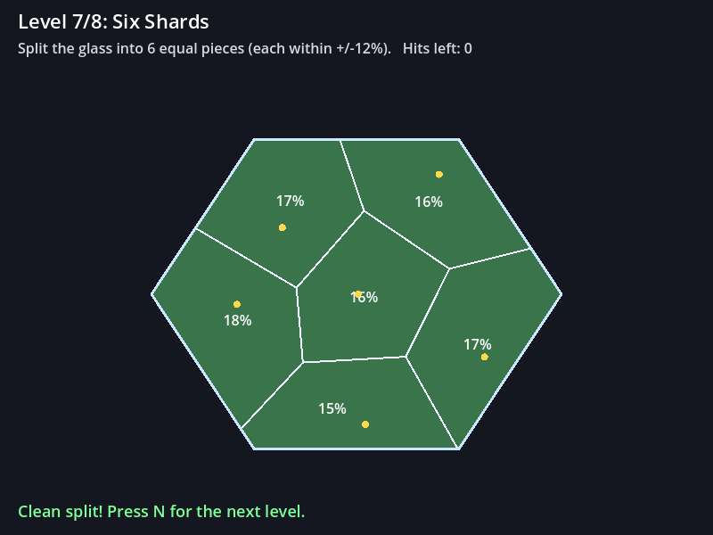
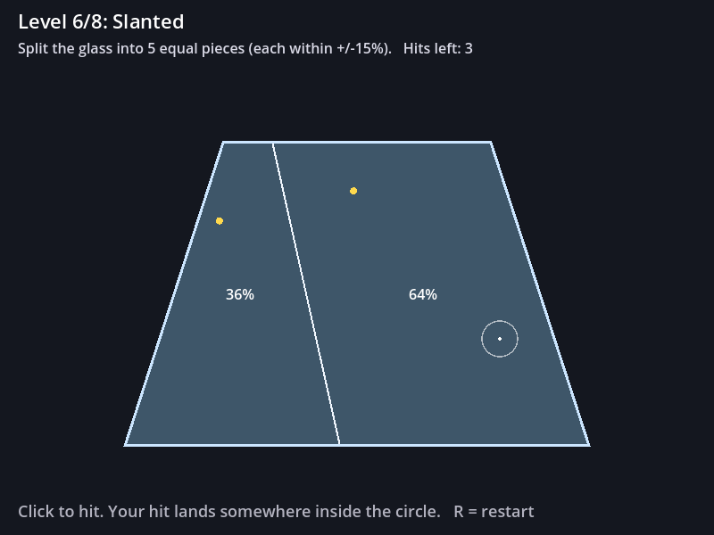
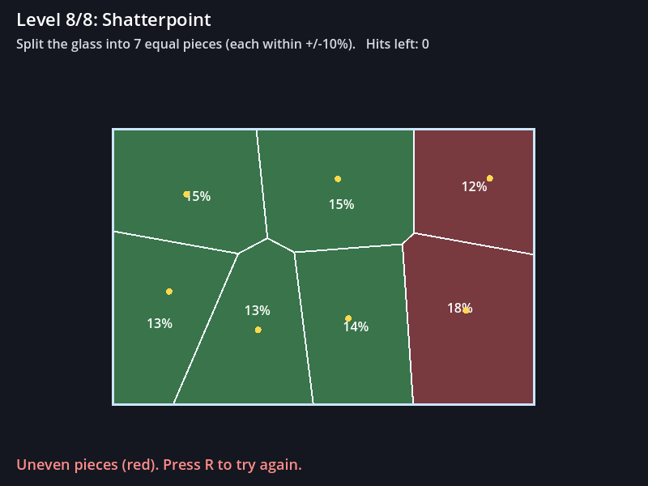
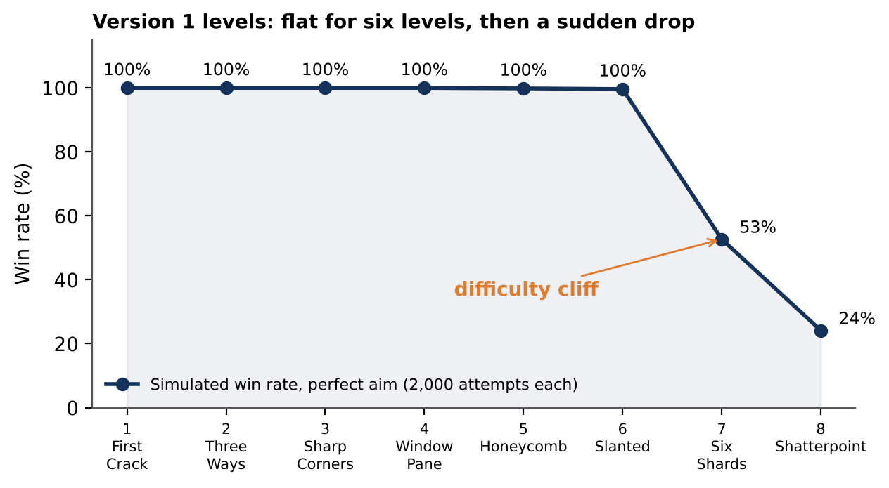
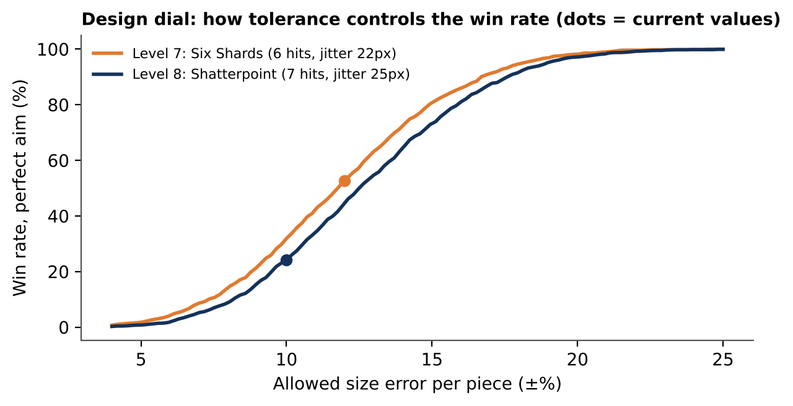

# Glass Cracks

**A puzzle game where every crack is a probability.** Made with Godot 4.



You hit a glass panel and must break it into pieces of equal size. Every hit lands at a random spot inside a small circle around your aim, never exactly on it. You can see the risk, so you plan around probability, not luck.

## How to play

| Key | Action |
| --- | --- |
| Left click | Hit the glass (the white circle shows where the hit can land) |
| R | Restart the level |
| N or Enter | Next level, after a clean split |

Each hit becomes the centre of one glass piece. When all hits are used, a piece turns **green** if its size is within the level's tolerance and **red** if it isn't. Every piece must be green to clear the level.

| Aiming | A failed split |
| --- | --- |
|  |  |

## Run it

1. Install [Godot 4.3+](https://godotengine.org/download) (standard version).
2. In the Project Manager click **Import**, select `project.godot`, then **Import & Edit**.
3. Press **F5** to play.

## Levels

All levels are defined in the `LEVELS` table at the top of `main.gd`. Balancing means changing numbers, not code.

| # | Level | Shape | Hits | Tolerance | Jitter (px) |
| --- | --- | --- | --- | --- | --- |
| 1 | First Crack | rectangle | 2 | ±20% | 8 |
| 2 | Three Ways | rectangle | 3 | ±20% | 12 |
| 3 | Sharp Corners | triangle | 3 | ±20% | 12 |
| 4 | Window Pane | rectangle | 4 | ±15% | 15 |
| 5 | Honeycomb | hexagon | 4 | ±15% | 18 |
| 6 | Slanted | trapezoid | 5 | ±15% | 20 |
| 7 | Six Shards | hexagon | 6 | ±12% | 22 |
| 8 | Shatterpoint | rectangle | 7 | ±10% | 25 |

## How it works

- **Pieces are Voronoi cells.** A piece is all the glass closer to its hit than to any other hit. The code starts from the full panel and, for every other hit, cuts it along the line halfway between the two hits (`compute_pieces()` in `main.gd`).
- **Fair randomness.** The landing point is uniform inside the circle: radius = jitter × √(random), so the circle the player sees is honest (`hit()`).
- **Scoring.** Areas use the shoelace formula. A piece passes if its share is within tolerance of 1 / hits.

## Difficulty analysis

`analysis/difficulty_sim.py` simulates a **perfect-aim player**. It finds the best aim points for each level (equal-area pieces), applies the game's random jitter and plays 2,000 attempts per level. That gives the highest win rate any player can reach.

```bash
cd analysis
pip install -r requirements.txt
python difficulty_sim.py        # about 1 minute
```



| Level | 1 | 2 | 3 | 4 | 5 | 6 | 7 | 8 |
| --- | --- | --- | --- | --- | --- | --- | --- | --- |
| Win rate, perfect aim | 100% | 100% | 100% | 100% | 99.9% | 99.7% | 52.7% | 24.1% |

**Finding:** version 1 has a *difficulty cliff*, not a curve. The randomness only matters in the last two levels. The tolerance chart shows how to tune it:



## Tests

```bash
godot --headless --path . -s res://tests/test_levels.gd
```

Plays every level with scripted hits and checks that the pieces always add up to exactly the full panel.

## Roadmap

- [ ] Version 2 level values with a smooth difficulty curve
- [ ] Playtest with 3–5 people and record what changed
- [ ] Sound and effects (cracking glass, falling shards)
- [ ] Web build on itch.io

## About

Made by [Sajal Kumar Das](https://github.com/fauskd) as part of my portfolio for the Game Design (M.A.) programme at TH Nürnberg. Developed with AI-assisted coding tools; design, testing and balancing decisions are my own.
